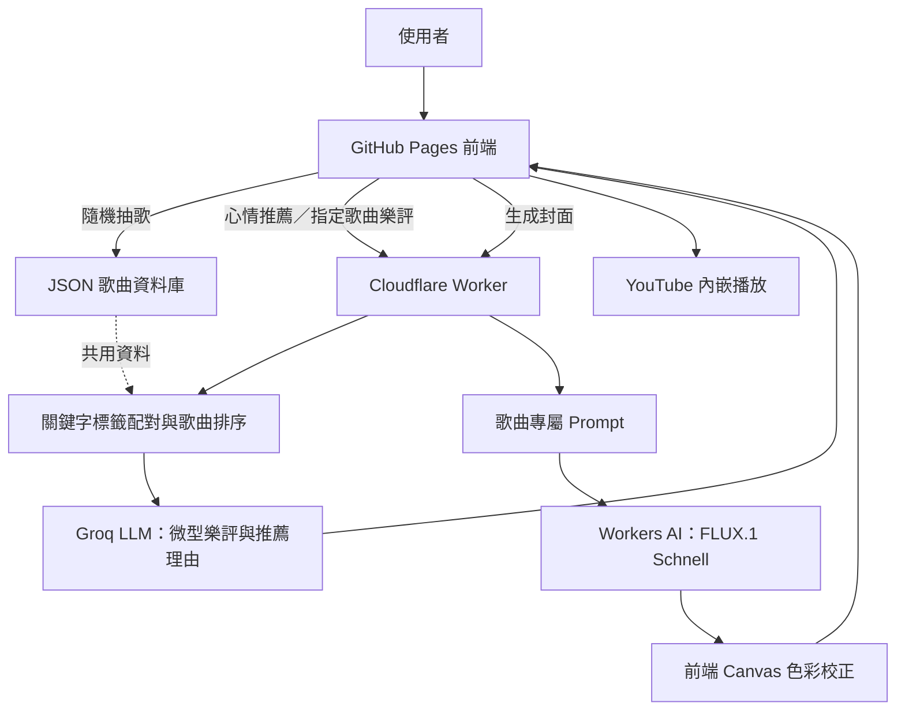

# 歌荒救星 · Indie Music Savior

> 讓一首歌，接住此刻的你。

一個結合獨立音樂探索、情境式歌曲推薦與生成式 AI 的互動網頁。用文字記下當下的心情，發現一首與自己同頻的歌曲，閱讀專屬微型樂評，並將歌曲的氛圍轉化成一張原創唱片封面。

**[開啟歌荒救星 ↗](https://eee111111111111111111111.github.io/indie-music-savior/)** · [部署與 API 設定](GROQ_SETUP.md) · [歌曲資料庫](docs/data/songs.json)

*生成式 AI：文字與圖像生成的原理與實務｜期末個人專案*

---

## 專案理念

面對大量串流音樂，選擇本身有時反而成為負擔。歌荒救星希望將「不知道要聽什麼」轉化為一次有情緒、有故事、也有視覺想像的音樂探索體驗。不同於單純的隨機播放，網站結合人工整理的歌單、情緒標籤配對、文字生成及圖像生成，讓每一次發現都能從聽覺延伸至文字與圖像。

## 核心功能

| 功能 | 說明 |
| --- | --- |
| 依心情找歌 | 根據自然語言中的情緒、曲風、場景、樂器與能量標籤，從既有歌單推薦歌曲。 |
| 隨機探索 | 瀏覽器內不放回抽樣，抽歌本身不呼叫 AI API；可為選中的歌曲另外生成樂評。 |
| AI 微型樂評 | 使用 Groq LLM 生成繁體中文樂評、選歌理由及視覺修飾建議。 |
| 原創唱片封面 | 以歌曲專屬意象、低飽和配色及藝術媒材建立 Prompt，交由 FLUX 生成真正的圖像。 |
| 柔和視覺處理 | 透過 Canvas 校正高彩度像素及明暗對比，可下載校正後的 JPG，亦可重新生成。 |
| 音樂播放 | 嵌入 YouTube 播放器，亦可前往 YouTube 聆聽。 |
| 創作細節 | 展開查看標籤及封面提示詞，了解推薦與創作的依據。 |

### 使用方式

1. 輸入心情，或點選情境範例，例如「陰天下午，想聽有點憂傷的 Lo-fi 搖滾」。
2. 點選「依心情找歌」；若想探索新音樂，可直接「隨機抽歌」。
3. 閱讀樂評與選歌理由。隨機抽歌預設顯示資料庫簡介，可按「生成 AI 樂評」。
4. 點選「生成專屬封面」，待模型完成後即可下載 JPG 或重新創作。
5. 透過內嵌播放器聆聽歌曲。

## 歌曲資料庫

目前收錄 **130 首歌曲、29 組不同歌手／樂團名稱**，以獨立音樂為核心，包含 indie rock、indie pop、dream pop、lo-fi 等曲風。每筆資料包含歌曲 ID、歌名、演出者、YouTube 影片 ID、曲風、情緒、場景、樂器、能量、簡介與封面設計設定。

| 歌曲示例 | 封面視覺方向（創意詮釋） |
| --- | --- |
| VOOID — 礦石 | 礦物晶體與細緻岩石質感 |
| SADOG — 我是海浪 | 海浪、岸邊與自然光影 |
| Sweet John — 又見大雨 | 雨水與玻璃上的光影 |
| The Chairs — 城市潛水 | 城市與水下意象 |

歌曲標籤與簡介仍有待試聽複核；封面設定是依提供的歌名與標籤進行的創意詮釋，非歌詞或音訊分析，也不是官方專輯封面。

## 技術架構



| 層級 | 技術 |
| --- | --- |
| Frontend | HTML5、CSS3、Vanilla JavaScript、Canvas API |
| Backend | Cloudflare Workers、Fetch API、Wrangler |
| Text-to-Text | Groq Responses API、`openai/gpt-oss-20b`、JSON Schema |
| Text-to-Image | Cloudflare Workers AI、`@cf/black-forest-labs/flux-1-schnell` |
| Data | JSON、歌曲情緒與視覺標籤 |
| Deployment | GitHub Pages、Cloudflare Git 整合 |
| Testing | Node.js 內建測試框架 `node:test` |

### 推薦演算法

本專案以關鍵字抽取情境標籤，不將整個歌單交由 LLM 自由生成。各歌曲依下列權重評分：情緒 40%、曲風 30%、場景 10%、樂器 10%、能量 10%。未指定的類別不計入分母；有正分時由前五名候選依分數平方加權抽樣，盡量避開上一首。無匹配時改為探索歌單。相似度是標籤配對分數，而非模型信心或音訊相似度。

### 生成式 AI 與資源控制

- **Text-to-Text：** 歌曲選定後，最多一次 LLM 呼叫，以結構化 JSON 回傳樂評、推薦理由及圖片建議；情緒標籤本身不是 LLM 分析。
- **Text-to-Image：** 歌曲專屬母題優先，使用者情境與 LLM 建議作為輔助。後端重新組合提示詞，按下封面按鈕後獨立呼叫 FLUX，無須再呼叫 Groq。
- **資源管理：** 隨機抽歌為本地操作；文字與封面在當頁保留有限快取，重新生成封面仍會發出新推論。額度或速率限制觸發時以倒數及資料庫簡介維持操作，並明確區分 AI 生成文字與資料庫文字。沒有自動切換付費 OpenAI 的機制。

## 專案結構

```text
indie-music-savior/
├── docs/                     # GitHub Pages 靜態網站
│   ├── index.html             # 網頁結構
│   ├── style.css              # 深色復古介面
│   ├── app.js                 # 互動、快取與色彩校正
│   ├── config.js              # Worker 公開網址（不含金鑰）
│   ├── cover-preview.mjs      # 瀏覽器端歌曲簡介與提示詞
│   └── data/songs.json        # 前後端共用歌曲資料
├── shared/
│   ├── catalog.mjs            # 歌曲資料匯入
│   ├── recommender.mjs        # 情緒標籤與推薦評分
│   ├── openai.mjs             # Groq／OpenAI API 介面
│   └── visual.mjs             # 歌曲專屬封面 Prompt
├── worker/index.mjs           # API、CORS、限流與模型呼叫
├── tests/                     # 自動化測試
├── wrangler.jsonc             # Worker 部署與公開設定
├── package.json
├── GROQ_SETUP.md              # 詳細部署與故障排除
└── README.md
```

## 快速部署

本專案可全程使用瀏覽器部署，不需要安裝 Python 或 VS Code。

1. 將專案檔案放到 GitHub Repository 根目錄，於 Settings → Pages 選擇 `main` 分支的 `/docs`。
2. 在 Cloudflare Workers & Pages 連接 Repository，Worker 名稱須與 `wrangler.jsonc` 的 `name` 一致，部署指令為 `npx wrangler deploy`。
3. 於 `wrangler.jsonc` 設定 `AI_PROVIDER`、`GROQ_MODEL`、`ALLOWED_ORIGIN`，保留 Workers AI 與兩個限流綁定；在 Cloudflare Secret 新增 `GROQ_API_KEY`。
4. 將 Worker 公開網址填入 `docs/config.js`，檢查 `/status` 及實際推薦、封面生成。

完整操作、環境變數、API 介面與錯誤排除請參考 [部署與 API 設定](GROQ_SETUP.md)。若是接手既有部署，不需重新建立 Worker 或申請金鑰。

## 測試與維護

有 Node.js 22 的開發環境可在專案根目錄執行：

```bash
npm test
```

測試使用模擬模型回應，無須真實 API Key，也不消耗模型額度。涵蓋歌曲資料完整性、前後端視覺模組一致性、情緒評分、指定歌曲樂評、Groq 請求與 429 備援、封面生成介面、CORS 及限流。實際 Groq／FLUX 與 YouTube 播放可用性仍須透過部署後的網站驗收。

新增歌曲請更新 `docs/data/songs.json`，為新曲設定唯一 ID、有效影片 ID 及 `cover_art`。更新 `shared/visual.mjs` 時，也需同步 `docs/cover-preview.mjs`。前後端各自部署，發布完成後才會同步使用新資料。

## 限制、隱私與使用注意事項

- 推薦僅涵蓋現有歌單；關鍵字匹配不能完整理解所有自然語言。尚未進行音訊分析、歌詞解析或個人化學習。
- 文字模型與圖片模型存在免費額度及速率限制；本專案的限流設定不代表服務商提供的配額。生成圖像亦不保證完全符合 Prompt。
- 心情描述會送到 Worker；使用 LLM 時會將描述與必要歌曲資訊傳給設定的模型供應商。請不要輸入敏感個人資訊。播放影片會連線至 YouTube。快取保留於當頁記憶體。
- API 金鑰僅存於 Cloudflare Secret。CORS 與近似 IP 限流不是完整的身分驗證，公開服務仍需監控用量；正式擴大開放前應考慮更嚴格的驗證與用量控管。
- 音樂及影片權利歸原權利人所有。本專案僅連結與嵌入 YouTube 影片，不提供音樂下載；生成封面不是官方唱片美術。

## 未來展望

- 逐首試聽與人工複核，提升歌曲標籤及封面母題的準確度。
- 擴充歌單與語意配對能力，透過使用者回饋評估推薦品質。
- 改善生成封面的風格一致性、失敗重試與跨工作階段快取。

## 參考資源

[GitHub Pages](https://docs.github.com/en/pages) · [Cloudflare Workers](https://developers.cloudflare.com/workers/) · [Workers AI](https://developers.cloudflare.com/workers-ai/) · [Groq Documentation](https://console.groq.com/docs/overview) · [YouTube IFrame Player API](https://developers.google.com/youtube/iframe_api_reference)

---

**Indie Music Savior** — 為每個難以命名的此刻，找到一首歌。
